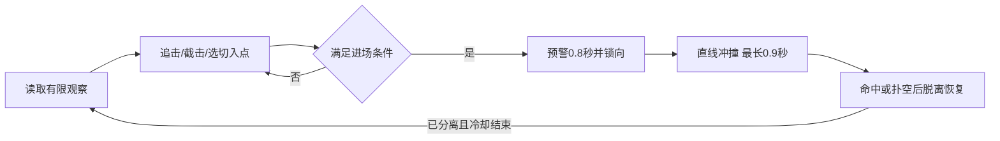

# AI 成长与反制方案（历史设计）

日期：2026-10-24。历史设计记录：当前实现已由用户确认的新基础循环继续重写，见 [四级成长与双模式推进验证](../03-test/AI四级成长与双模式推进验证.md)。以下停车预警、预先锁向和阶段伤害白名单不适用于当前 Battle。原记录状态为只提交设计、等待审阅。本文件中的参数是调试起点和验收目标，尚未在新机制上实测；现有代码与测试通过记录不代表本方案已经完成。

## 目标与首版范围

让玩家明显感觉敌机逐渐会判断运动、选择进攻角度和掌握节奏，同时能学会、重复使用一套躲避规则。玩家停车不响应预警仍会被追上攻击；正确响应预警的玩家应能避免伤害。

推荐首版在当前 Battle 的一架敌机、开阔战场、WASD 飞行、5 HP 和 2 秒无敌基础上完成“有限信息 → 战术选位 → 公开攻击时序 → 脱离重整”。伤害仍为一次有效撞击扣 1 HP。

后续有两条独立扩展路线：增加多架敌机，做攻击名额和侧翼角色协调；增加真正的遮挡/障碍与脱战目标，做视线、暴露和搜索图。本次评审先围绕单敌机版本，避免把这些前提尚不存在的系统写成已具备的能力。玩家武器、敌机血量和击杀胜利条件需要另外设计；本版的反制收益是躲开、拉开和获得恢复空间。

## 一手材料与实际借鉴关系

1. Travis McIntosh，*Human Enemy AI in The Last of Us*，Game AI Pro 2，第34章，书页419–429。[原作者公开章节](https://www.gameaipro.com/GameAIPro2/GameAIPro2_Chapter34_Human_Enemy_AI_in_The_Last_of_Us.pdf)。
2. Ming-Lun “Allen” Chou，Naughty Dog，GDC 2021，*Melee AI in The Last of Us Part II*，46页讲义。[官方讲义](https://media.gdcvault.com/GDC+2021/Melee+AI+in+The+Last+of+Us+Part+II.pdf)，[GDC讲座页](https://www.gdcvault.com/play/1027115/Melee-AI-in-The-Last)。已读取本地讲义并核对第8、10、12、13页及后续空间分析内容。
3. Travis McIntosh，GDC 2014 原讲座的[B站双语转载](https://www.bilibili.com/video/BV11JTMe6EtN/)。重点核对41:40–43:10的战斗参数与按局势调整示例。

| 原作中可核对的机制 | 本项目采用的手段 | 原因与玩家收益 |
|---|---|---|
| 第34.3节：感知与带时间的目标记忆 | 战术层只使用延迟后的观察状态；保留观察时间、速度与置信度 | 突然转向可以破坏旧预测，敌机不读取玩家按键或未来操作 |
| 第34.4节：候选站位及其到达路径共同参与评价 | 生成侧向切入、攻击准备和退出候选点；先过滤不可达/危险路径，再评价角度、机动代价和出口 | 增强体现在选择好位置，避免终点合理但过程贴脸或撞墙 |
| 第34.5节：高层技能与低层行为分层 | 战术决定追击/截击/侧切，攻击时序统一管理预警、冲撞和恢复，底层只执行飞行输入 | 脱离、死亡等优先级明确，减少状态相互争夺 |
| 第34.8节：用稳定战斗方向组织侧翼 | 本轮进场先选定参考方向和左右侧，不随玩家每帧转头就跳换航点 | 玩家能看出敌机要从哪边切入，也能主动改变相对位置 |
| 《美末2》讲义第8/10/12页：明显前兆、可闪避、攻击条件和命中事件 | 公开预警、方向承诺、冲撞伤害窗口和扑空恢复 | 玩家看懂后能够躲开，成功躲避不会被后续追踪修正取消 |
| 2014讲座41:40–43:10：战术参数可按局势配置 | 按战斗阶段开放更复杂的策略，切换只在攻击回合结束后发生 | 成长可解释，玩家当前正在应对的规则不会突然改变 |

上述是机制摘要；下面的飞机参数、时间成长表、预警航线、锁向规则与短期动作习惯统计是本项目的适配设计，不是原作提供的空战算法。《美末》也存在服务节奏的全局信息例外，不能描述成绝对不使用全局信息。

## 所有等级共享的公平规则

玩家机型保持最大速度9、转速240°/秒。建议敌机统一改为最大速度9、转速210°/秒，加速度18及阻尼/侧滑参数沿用现有模型。普通逼近速度约7.5–8，冲撞时才使用最大油门。等级不再逐步把敌机机体提升到12/300。

| 规则 | 提案值/约束 | 设计理由 |
|---|---|---|
| 冲撞预警 | 所有等级固定0.8秒 | 给玩家稳定可学的反应窗口；最高等级也不压缩 |
| 方向承诺 | 预警开始即确定本次方向；之后不重瞄玩家 | 玩家在看到航线后变向会真正改变结果 |
| 冲撞动作 | 最长0.9秒；沿锁定方向，转向输入为0 | 形成可以诱导扑空的攻击，不变成持续追踪的导弹 |
| 伤害窗口 | 仅冲撞阶段可造成接触伤害；每个攻击编号最多扣一次血 | 防止准备、侧移和飞离时的擦碰暗中扣血 |
| 扑空恢复 | 各等级1.8/1.6/1.4/1.2秒；绝不低于1.2秒 | 玩家成功闪避后有机会重新加速与选方向 |
| 命中后 | 立即停止本轮伤害，飞离；玩家2秒无敌结束前不启动下一次预警 | 避免重叠连续扣血和无敌结束立即再撞 |
| 再组织进攻 | 已恢复且曾真实分离至少3.5单位；重新满足进场条件 | 回合之间有真实脱离，防止贴着玩家等待计时 |
| 规则升级 | 从预警开始到本次最短恢复结束，冻结本轮参数；其余追踪、选位和受压重整期间可升级 | 正在显示的动作不会变化，也不因一直未出手而卡住等级 |

只有冲撞可伤害是本方案对当前接触伤害规则的一项明确修改。恢复中的敌机显示蓝灰色与“恢复中”，前摇黄色、冲撞红色；状态不能只靠颜色区分。当前玩家没有武器，因此恢复窗口是脱离机会，不宣称已经可以反杀。

## 一个攻击回合

**进场条件：** 玩家仍存活；敌机已经减速并对准候选方向；开始预警时双方中心距建议4.5–5.5；敌机和完整预警可见；真实飞行预测显示攻击与退出路径在战场内；至少一侧保留合理的玩家避让空间。条件不成立时重新选位，不靠瞬间转头或突然加速强行发招。

公平准入检查若使用双方真实状态，只允许否决不可躲或不安全的起手，不能把真实目标坐标、速度或更优方向回传给战术层用于瞄准/选位。它不读取玩家未来输入；这条只保护玩家的通道需要专项测试，避免绕过有限观察的约束。

预警开始前要求残余侧向速度足够小，暂以0.3单位/秒为起点。预警期间只对准已确定的方向并刹车，不再追着玩家瞄准。进入预警后，即使玩家变向，也照已公开方向完成本轮动作；只有目标死亡/失效或路径被外部变化阻断才取消，取消也需进入恢复，不能立即换方向再发。

航线用与真实积分相同的机型和输入预测，显示有宽度的危险走廊。两机合计碰撞半径为1，因此走廊半宽为1、全宽为2，表示玩家中心进入此区域会有接触风险。方向锁定不等于假设飞机已经停止：绘制时必须考虑残余惯性和边界截断，不能画出与实际运动不一致的细直线。

距离不能用“极速乘时长”随意确定。例如从静止、加速度18、速度上限9，在不考虑阻尼的理想情况下0.9秒约前进5.85单位，所以进场距离先取4.5–5.5，并仍需真实 FlightModel 校验。若实际轨迹够不到或没有出口，就不选择该攻击。

## 四级成长表

时间按战斗模拟时钟计算；暂停、重复读取AI、HUD刷新都不能加速成长。20/40/60秒只是首版可调的阶段点，具体战术是否有条件使用仍由当时的观察与空间决定。

| 阶段 | 增强的具体手段 | 初始参数提案 | 玩家反制与原因 |
|---|---|---|---|
| Lv1，0–20秒：学规则 | 朝最近观察到的位置逼近，主要正面进场 | 感知信息延迟0.35秒；不做速度外推；巡航7.5；扑空恢复1.8秒 | 看预警后W+A/D离开航线。先让玩家建立可靠的动作理解 |
| Lv2，20–40秒：会截击 | 用已观察速度推算有限距离的切入点，优先选转弯代价较低的进场 | 信息延迟0.25秒；速度预测上限0.30秒；巡航7.8；恢复1.6秒 | 锁向后刹车或改变航向使旧预测失效。增加信息利用能力 |
| Lv3，40–60秒：会选角度 | 从左右侧前方候选点选择进场，减少长时间尾随；不来回抖换左右侧 | 延迟0.20秒；16个候选点；巡航8；恢复1.4秒 | 提前改变相对位置，或在锁向后侧向躲开。相同机体通过更好的站位构成威胁 |
| Lv4，60秒后：会组合 | 在直接追击、速度截击、侧向进场之间按观察选择；参考最近4次已观察到的避让方向，改变下一轮进场角度 | 延迟下限0.15秒；预测上限0.45秒；巡航8；恢复下限1.2秒 | 不固定重复同一绕法，仍可在公开预警后改变选择。增加战术覆盖和出手机会，不取消基本躲法 |

感知层可按10Hz采样，将达到规定延迟的旧观察交给战术层；飞行积分仍为50Hz。延迟与外推量分别记录，避免把预测包装成读取实时真值。任何外推只根据历史位置/速度，具有时限；低置信度时退回简单追踪。

Lv4的短期统计只记录玩家实际已经走出的轨迹，不能读取键盘、下一帧输入或未发生的变向。统计只能影响下一轮选位，不能改变已经锁定的攻击。这是有限策略记忆，不需要训练模型，也不宣称是《美末》原作的在线学习系统。

单敌机空场景中，满速直线拉开可以成为有效防守；不要用隐藏超速取消它。场地有限，转向和进场仍会产生交手机会。若后续想要求玩家必须交战，应明确增加任务目标或武器玩法。

另一个有效反制是持续贴身追压：玩家的转向更强，可能使敌机长期拉不开进攻距离。允许这种需要持续操作的压制。敌机此时显示“重整/受压”，继续刹车变向、向场内让行或重新选出口；每2.5秒可更换脱离方案，但不重置恢复总计时。不以隐形伤害或临时超速强迫玩家让开；玩家停止追压后，敌机必须能重新拉开并发起攻击，不能退化成永久停车。

## 选位、记忆与节奏如何工作

**候选点：** 在已观察的目标附近生成直接接近点、左右侧向切入点和退出点。先剔除越界、进场前就会穿过玩家、残余速度下无法到达、冲过后没有退出空间的点；再比较攻击角度、到达耗时、转向成本、出口宽度和最近是否反复走同一路线。选定一侧后保持一段战术周期；只有明显更优或旧点失效才切换。

这借鉴Post Selector评价“去哪以及怎么去”的方法。首版使用硬条件过滤加评分，具体评分公式不必照搬原作的乘积组合。开放场景没有真实掩体或遮挡，不把侧后方称为玩家看不到的地方，也不伪造暴露图。

**观察与记忆：** 感知层与战术层隔离，战术层看不到玩家原始实时状态。当前开阔场景可以保持持续可见，不引入视野锥使敌机背向时反复丢目标。未来加入障碍后，再让不可见时的最后已知位置、置信度衰减和搜索范围扩散真正参与玩法。

**节奏：** 时间控制可用战术，攻击条件控制能否出手。准备、冲撞、恢复有明确优先级和截止条件；恢复不因航点刷新重置计时。首版使用公开的时间成长和固定伤害规则，先不叠加隐藏的表现驱动难度，以便解释和重放。

如果未来加入多敌机，再实现与原作协调器相对应的攻击名额和角色分配：限制同时进入预警/冲撞的数量，其他敌机占位或侧切。本版只有一架敌机，不把一个状态机包装成完整小队协同。

## 玩家看到的反馈

- 黄色前摇倒计时、带宽度的锁定航线；冲撞期间方向保持一致。
- 红色冲撞状态、蓝灰色恢复状态，并有文字/形状区别；音效可辅助，不能作为唯一提示。
- HUD分别显示等级和意图，例如“Lv3 / 侧向进场”，不能只用一个THREAT百分比代替行为变化。
- 保留HP和无敌闪烁，死亡时显示重开，不继续显示冻结的无敌倒计时。
- 首版不从画面外启动冲撞；若以后允许，必须先另做足够清楚的边缘来袭提示。

## 验收方式

以下都是实现后的验收目标，不是已完成结果。

1. **攻击有可操作的解。** 复用真实 FlightModel 与相对扫掠接触检测。测试玩家静止、半速、满速，各种机头、迎面/侧向/背向、墙边与四角。预警出现后先延续原输入0.30秒，再执行合法的W+A或W+D等候选躲避。对所有允许发起的标准进场样本，至少存在一条不越界、不会被该次冲撞伤害的轨迹。失败样本需要修改进场条件或动作参数，不能删掉后宣称公平。
2. **反制可以连续使用。** 用只读取公开预警的测试玩家，分别跑四个等级与跨等级的60秒回合；记录攻击/扑空/伤害、反应时间与失败轨迹。测试玩家必须遵守原加速度和转速，不新增闪避键、瞬间横移或额外无敌。静止玩家要用W配合转向，单按A/D只转机头不构成位移。
3. **敌机有成长且仍有威胁。** 不响应预警的静止玩家会被正常多次命中；追踪不能永远停在距离外。对直飞、盘旋、固定蛇形、锁向后变向等同一组策略，比较不同等级的切入角度、有效攻击机会、扑空和伤害；高等级应显示合理的战术优势，不能只改等级标签，也不以“所有策略必死”为通过条件。
4. **公平约束不越界。** 所有等级预警0.8秒；锁定后无重新瞄准；冲撞最多0.9秒；恢复不低于1.2秒；一次攻击最多扣1HP；非冲撞段不伤害；无敌期内不扣血。阶段切换、碰撞和无敌到期的同一固定步需要专项检查。贴身追压允许阻止起手，但停止追压后必须恢复正常攻击；不能用永远拒绝起手通过公平性检查。
5. **保留工程可靠性。** 覆盖边界、重叠出生、目标失效、死亡/重开、有限数值、输入范围、原卡死seed、相同输入重放、重复ReadInput不推进时钟。分别运行纯C#、Unity EditMode和实际Battle PlayMode；再做实际键盘试玩，核对提示与命中是否一致。

不预先承诺尚未测出的躲避率、胜率或平均存活时间。需要同时交付“可躲的证明轨迹”和“有威胁的命中轨迹”，然后根据实际试玩调整阶段时长与评分。

## 实施边界（批准后执行）

继续保留纯C#决策与飞行模型边界。拟拆分为感知记忆、战术选位、攻击时序、难度配置四个职责；低层照旧输出FlightInput，伤害仍由唯一ContactCombatModel结算。伤害模型另读明确的攻击编号/伤害有效窗口，不允许HUD、AI和物理回调分别扣血。

准备工作顺序为：先完成公开攻击时序与反制回归，再接有限观察和选位，随后开放四级策略，最后做反馈与实测。用户审阅本方案并确认范围后，才开始编写实现与测试代码。
