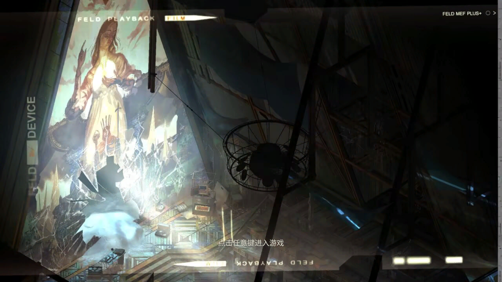
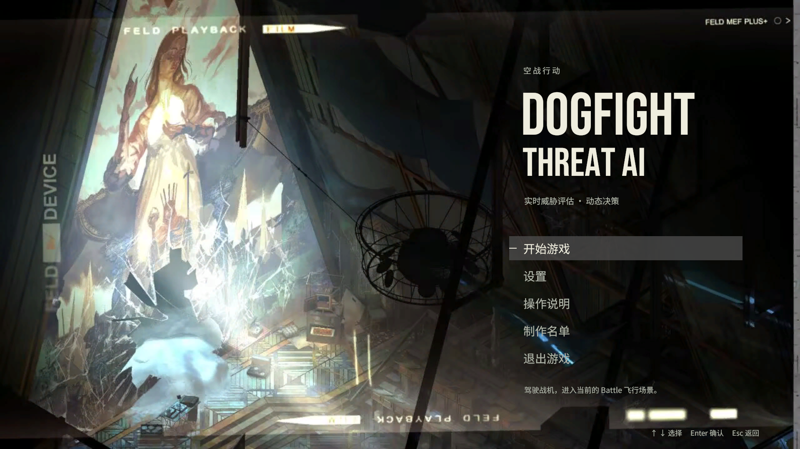
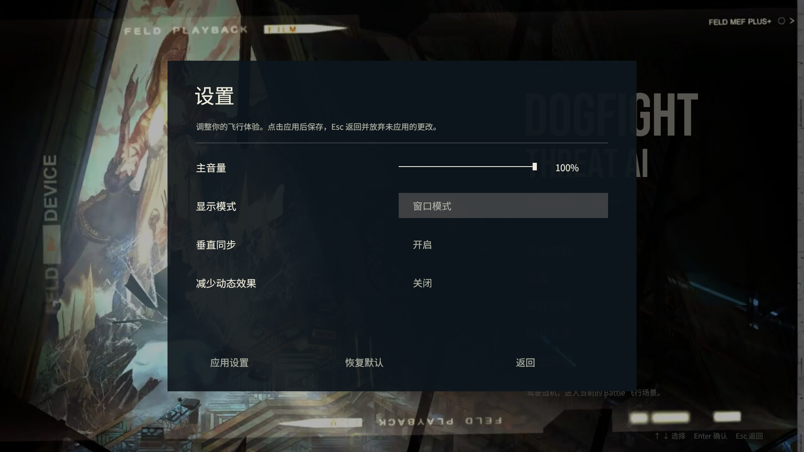
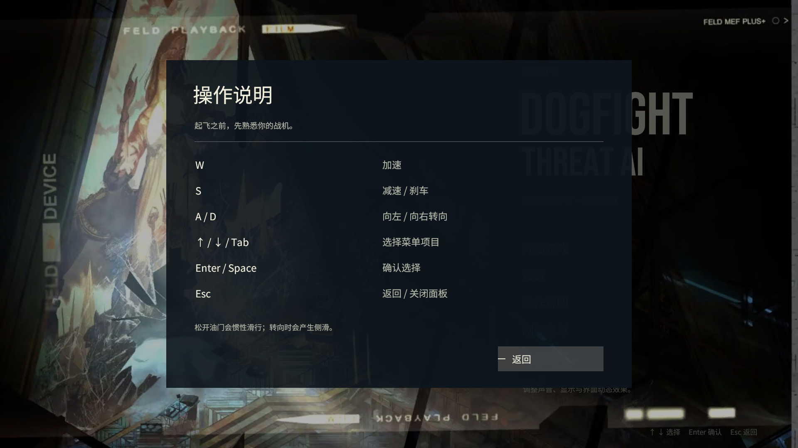

# 开始界面验证记录

日期：2026-10-24。

## 环境

使用本机团结引擎 2022.3.62t16（编辑器 1.10.4，DX11）运行 Unity 2022.3 项目的验证副本。副本保留菜单、飞行代码、原始场景和资源，并只加载 uGUI、Unity 内置模块与本地测试包，减少非功能性工具包对验证的影响。仓库的 Packages、ProjectSettings 与目标 Unity 版本没有升级。

## 已完成

- 菜单 Player 与 Editor 条件编译通过；原有 **16/16 EditMode 测试通过**，新增 **4/4 PlayMode 菜单流程测试通过**。详见 [测试结果摘要](evidence/test-results-summary.json)。
- 编辑器成功导入资源，无脚本编译错误；使用 Unity 编辑器序列化并保存原生 Canvas、背景、文字、按钮、事件系统和控制器引用。
- 已在编辑器 Play 模式实际运行，记录以下 8 项通过结果：
  1. 从 Menu 场景加载原生菜单控制器。
  2. 初始状态为任意键提示。
  3. 提示与菜单过渡完成。
  4. 主菜单可交互。
  5. 设置面板打开。
  6. 设置面板关闭并返回菜单。
  7. 实际加载项目原有 Battle 场景。
  8. 场景切换后原菜单被销毁。
- 修复实机验证发现的英文标题被 Text 高度截断问题，添加菜单失焦后的键盘焦点恢复；背景关闭 NPOT 缩放以保留原图宽高比。
- 最终截图为编辑器 Play 模式直接生成的 1920×1080 图像。临时截图驱动和窗口尺寸工具只存在于验证副本，不进入项目交付。
- 截图完成后已从验证副本的 Assets 移除自动截图与自动跳转驱动；重新进入 Play，无任何按键或点击，等待超过 6 秒后仍停留于初始任意键提示。
- 保留原始 Main Camera 和场景全局配置，将团结引擎写入的格式标记及 GameObject 序列化字段恢复为原 Unity 2022.3 场景约定，检查全部场景内部引用有效。
- 检查新增资源与代码的 .meta 配对、中文字体字形和文档相对链接。

[实际运行检查记录](evidence/unity-runtime-checks.txt)

## 实际截图

## 后续环境验收
- 完整确认设置保存、重启恢复，以及独立包中的窗口/全屏和垂直同步行为。
- 本次已在团结引擎运行；目标 Unity 2022.3.62f3c1 的导入及独立包运行仍需目标环境验收。

## 变更记录

- 2026-10-24：完成原生场景生成、编辑器 Play 验证，记录 8 项运行检查与实际截图。
