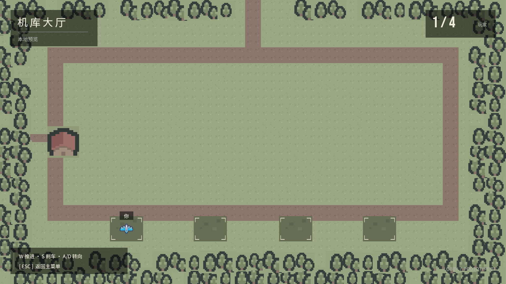

# 机库大厅验证

日期：2026-11-02。使用本机 Unity 2022.3.62f3c1。

## 结果

- Unity 正式编译及场景构建成功，未检测到 C# 或大厅 Shader 编译错误。
- 全部 EditMode 测试：460 通过，0 失败，包含新增的 5 项大厅纯逻辑测试。
- 定向 PlayMode 测试：7 通过，0 失败。覆盖新增大厅流程、现有菜单设置/面板，以及菜单与战斗场景的往返。
- 已检查从实际 LobbyScene 渲染的 1920 × 1080 预览，确认地图、四个停机位、飞机、人数与操作提示均显示。

## 新增覆盖

`LobbySimulationTests` 验证静止出生、推进与刹停、转向与边界、不同实例隔离，以及非法输入/时间步不会污染状态。

`LobbyFlowTests` 通过主菜单真实按钮事件进入大厅，检查配置、模拟、Tilemap 和 `1 / 4` 显示，并确认没有 BattleCombatController；随后通过 HUD 退出事件返回主菜单，确认大厅控制器已卸载。

键盘手感尚需人工试玩；自动化移动测试直接向纯 C# 模拟提交意图。当前不是已接通网络的多人房间。

## 证据

- [EditMode 结果](evidence/lobby/editmode-results.xml)
- [PlayMode 结果](evidence/lobby/playmode-results.xml)
- [实际场景预览](evidence/lobby/lobby-preview.png)

