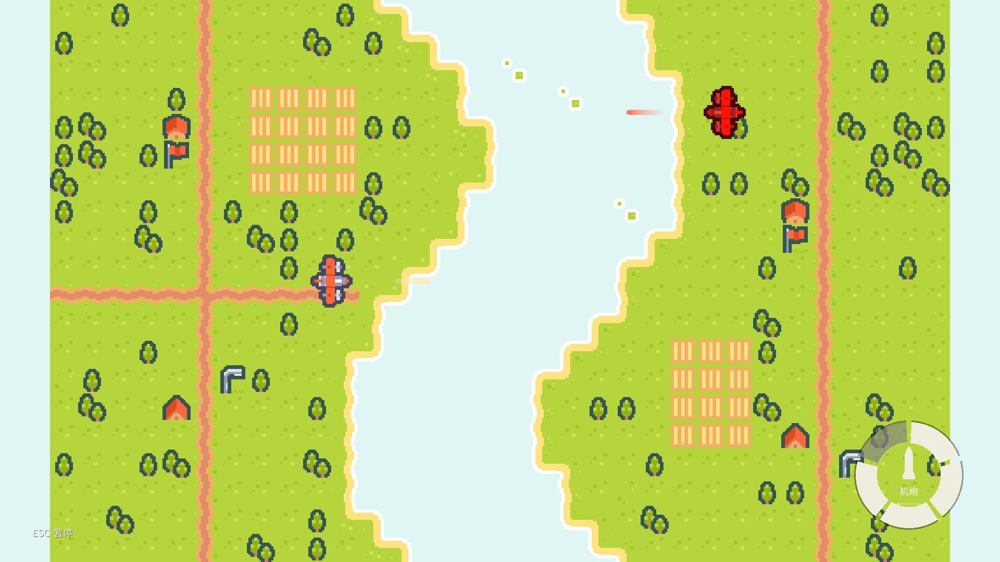
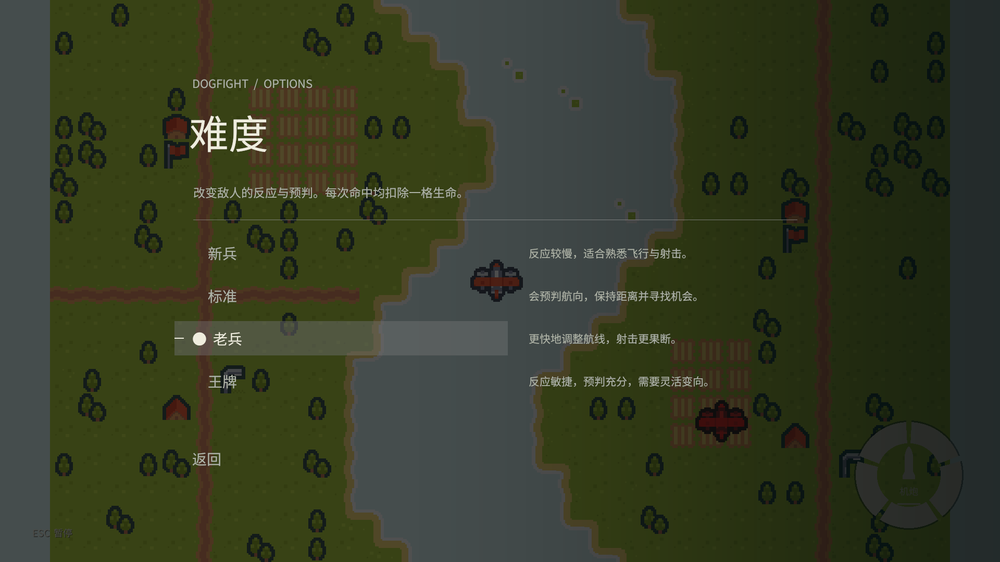
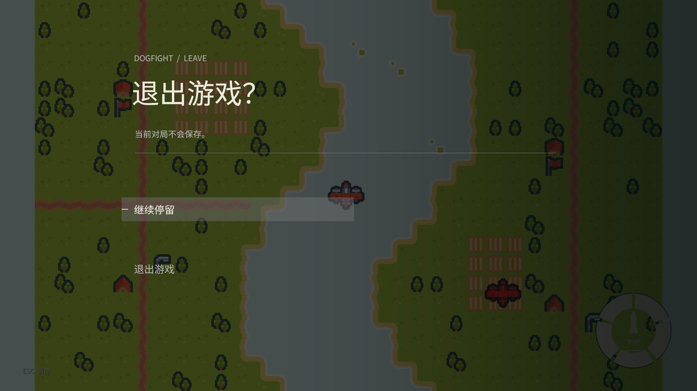

# 机炮与五段圆环 HUD 验证

日期：2026-10-25
实际引擎：团结 2022.3.62t16 / 1.10.4。未把本机结果表述为已在原 Unity 2022.3.62f3c1 上运行验收。

## 自动验证

| 套件 | 通过 | 失败 | 范围 |
|---|---:|---:|---|
| 全部 EditMode | 449 | 0 | 既有飞行/AI 逻辑，加弹丸、BFS/A*、通用行为树、射击反应与间距 |
| 全部 PlayMode | 68 | 0 | 菜单、场景往返、真实机炮接线、五段环渲染、暂停/难度/退出，以及旧撞击兼容回归 |

可逐项核对 [测试摘要](evidence/cannon-combat/results-summary.json)。原始引擎日志及 XML 保存在本机 `out/`，不将本机路径和许可日志打入交付材料。

本轮重点覆盖：

- 玩家与敌机从自己的机头发射，使用相同的弹速、硬冷却、伤害与寿命。
- 长按限速发射、短按缓存、暂停点击不泄漏为开火。
- 高速弹丸与移动目标的相对扫掠判定；到期回收、保护期间消耗弹丸、五次有效命中结束对局。
- 飞机彼此接触不造成伤害。
- 原生圆环确有 CanvasRenderer 和生成的网格，不仅检查健康数值；四格状态实际画面见下。
- 暂停冻结模拟，恢复时还原时钟；难度应用与保存，退出取消、胜负界面、主菜单往返及新对局状态清空。
- BFS 最短步数、阻挡与不可达、A* 带权绕行；60 张固定种子障碍图比较 A* 与 BFS 的最短路径。
- Selector 优先分支可打断 Running 行为，Sequence 的条件失败/Running 正确阻止后续动作；游戏内 GunnerPilot 实际调用相应寻路和行为树。

旧 PlayMode 撞击断言通过 `LegacyRamFixture` 显式启用历史模型，不把“接触掉血、时间成长”混入当前射击规则。重开测试按当前菜单保存的固定难度验证。

## 难度对照与边界

通过 `Tools → Dogfight Threat AI → Audit Gunner Difficulties` 运行固定步对照。每档分别运行直线、持续转弯、周期变向三种目标航线，每种 60 秒；目标速度 9，双方半径 0.5，保护 0.7 秒。探针临时设置 1000 生命，避免五次命中提前结束导致样本截断；实际游戏仍为五格。

| 难度 | 三种航线合计开火 | 合计有效命中 |
|---|---:|---:|
| 新兵 | 55 | 33 |
| 标准 | 81 | 69 |
| 老兵 | 213 | 99 |
| 王牌 | 294 | 148 |

[逐航线原始 CSV](evidence/cannon-combat/gunner-balance.csv)。修正了新射击 Pilot 初版“提高速度后反而频繁贴身、错失开火”的倒挂，交战时会匹配目标速度保持间距，并按资产中的射击节奏主动留出机会。

这些数据只证明该组固定航线下总体压力上升。单条航线不保证每档严格递增，例如直线航线标准命中 31 次、老兵 24 次；也未替代真人手感平衡。当前为初版射击 AI，无威胁热力图、掩体/小队决策或空中障碍规避。地面建筑仅为美术，实际地图的 BFS/A* 查询使用开放网格；障碍及加权场景由独立算法测试覆盖。

## 引擎渲染画面

下图通过 PlayMode 中真实相机和同一份原生 uGUI 离屏渲染为 1920×1080；使用测试控制的飞行、开火和生命快照，不是网页或效果图。







## 资源与架构检查

- Core 保持 `noEngineReferences: true`，新武器、寻路和行为树不依赖 Unity。
- UI 不引用 Gameplay 或 Core；Gameplay 通过 `BattleUiPresenter` 转发显示值及菜单命令。
- 未新增程序集或全局对局单例。武器与难度配置为资产，运行状态由纯模拟持有。
- 保留原资源 GUID；39 个团结新生成的编码 meta GUID 使用引擎导出的原始标识规范化为 32 位形式，方便随 Unity 工程交付。项目内 389 个标识检查无重复；规范化后再次运行 7 项新玩法 PlayMode，全部通过。
- GameScene 只增加机炮模式、武器/难度引用；StartMenu 补上已有遮罩所需的 CanvasRenderer。场景保持原 Unity YAML 标记，未将团结重写的无关场景字段混入。
- 本机原有 Packages/ProjectSettings 改动不属于本轮功能提交范围。

## 复跑

在团结/Unity Test Runner 中分别运行全部 EditMode、PlayMode；也可用编辑器命令行：

```text
-batchmode -projectPath <工程绝对路径> -runTests -testPlatform EditMode -testResults <结果.xml> -logFile <日志>
-batchmode -projectPath <工程绝对路径> -runTests -testPlatform PlayMode -testResults <结果.xml> -logFile <日志>
```

只看新玩法可设置 `-testFilter CannonBattleTests`；历史撞击测试带有 `LegacyRam` 分类。设置 `DOGFIGHT_CAPTURE_DIR` 环境变量时，新玩法 PlayMode 测试会输出原生渲染画面。
